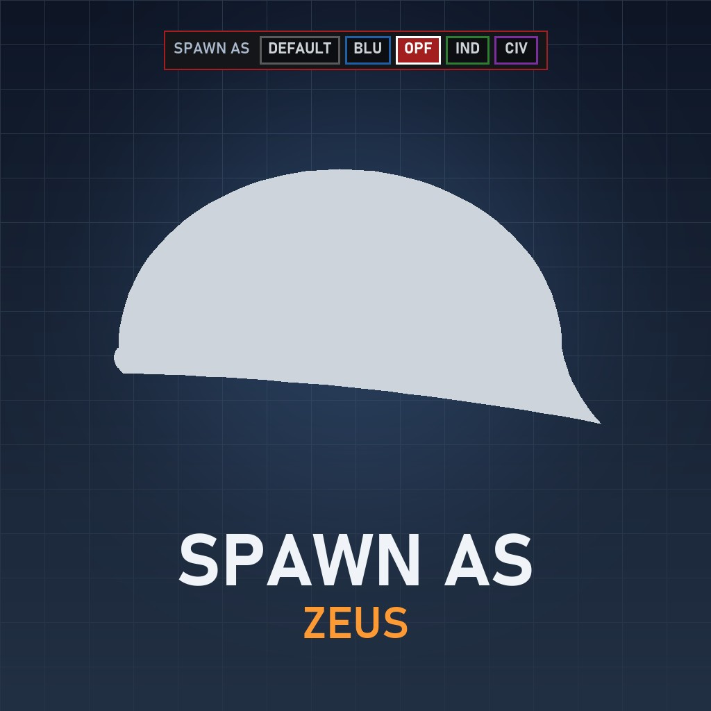

# Spawn As (Zeus)



An Arma 3 mod that lets Zeus pick **which side newly placed units join**. Want NATO troops as the enemy? Select **OPF** and place them from the BLUFOR tree: they are OPFOR the moment they hit the ground. No spawning far away and changing sides afterwards, no friendly firefight.

## Features

- **Spawn As strip** right next to the side tabs of the Zeus Create panel: **DEFAULT / BLU / OPF / IND / CIV**.
- **Instant**: units join the chosen side in the same moment they're placed.
- **Everything that brings soldiers**: units and groups from the Units, Groups and Recent trees, and the crews of crewed vehicles (the vehicle follows its crew).
- **Only the side changes**: uniform, gear, voice and insignia stay.
- **Banner** under the mission clock while a side is active, so you don't forget it's on.
- **Keybind** to cycle the side (CBA, rebindable), default **Ctrl+Shift+S**.
- Side colors follow your map color profile, like the vanilla side tabs.
- Every Zeus has their own setting; it starts at DEFAULT each mission.

## Download

**[Subscribe on the Steam Workshop](https://steamcommunity.com/sharedfiles/filedetails/?id=3839655588)** (recommended), or get the latest build from the **[Releases page](https://github.com/CodeTappert/ZeusSpawnAs/releases)**.

Unzip it; it contains the mod folder `@zsa`. In the Arma 3 Launcher, go to **Mods → ⋯ More → Add watched folder** (or **Add local mod**) and pick `@zsa`.

For servers that verify signatures, copy the `.bikey` from `@zsa/keys` into the server's `keys` folder.

## Requirements

- [CBA_A3](https://steamcommunity.com/sharedfiles/filedetails/?id=450814997)

Works with and without [Zeus Enhanced](https://steamcommunity.com/sharedfiles/filedetails/?id=1779063631).

In multiplayer, load the mod on the **server and all clients**.

## Usage

1. Open Zeus. The **SPAWN AS** strip sits left of the side tabs of the Create panel.
2. Click a side (or press **Ctrl+Shift+S** to cycle). A banner under the clock shows the active side.
3. Place units, groups or crewed vehicles as usual. They join the chosen side.
4. Click **DEFAULT** to go back to normal spawning.

Left alone: empty vehicles and objects, modules (including spawner modules with their own side setting), markers and everything already on the map. Use ZEN's "Change Side" for existing units.

## Known limitations

- Placed groups get a new group (new callsign); their units keep everything else.
- Units spawned by modules or scripts are not affected, only what Zeus places directly.

## Build from source

The mod is built with [HEMTT](https://hemtt.dev):

```bash
winget install BrettMayson.HEMTT
hemtt build      # unsigned dev build into .hemttout/build
hemtt release    # signed build into .hemttout/release + zip in releases/
```

Load `.hemttout/build` in the launcher as a local mod, together with CBA.

### How it works

| File | Purpose |
| --- | --- |
| [`addons/main/config.cpp`](addons/main/config.cpp) | Registers the functions, hooks the Zeus display load (CBA `Extended_DisplayLoad_EventHandlers`) and defines the chip button and centered text controls. |
| [`fn_init.sqf`](addons/main/functions/fn_init.sqf) | `postInit`: adds the `CuratorObjectPlaced` / `CuratorGroupPlaced` handlers to every curator module and the CBA keybind. |
| [`fn_switchSide.sqf`](addons/main/functions/fn_switchSide.sqf) | Moves placed units into a new group of the chosen side (where the units are local). |
| [`fn_initDisplay.sqf`](addons/main/functions/fn_initDisplay.sqf) | Builds the strip and banner each time Zeus opens and hides them together with the Zeus interface. |
| [`fn_setSide.sqf`](addons/main/functions/fn_setSide.sqf) | Sets the side and refreshes chip colors and banner. |

### CI

[CI](.github/workflows/ci.yml) builds a signed release on every push and pull request (download it from the run's artifacts). A push to `main` publishes a GitHub release `v<version>` if that version isn't released yet.

### Releasing

The version lives in [`.hemtt/project.toml`](.hemtt/project.toml) and is shared by GitHub and the Workshop.

1. On `develop`: bump the version in `.hemtt/project.toml` and add an entry to [`CHANGELOG.md`](CHANGELOG.md).
2. Merge `develop` into `main` → CI publishes the GitHub release.
3. With Steam running, on `main`: `hemtt publish`. It uploads the build, the Workshop description ([`.github/workshop/description.md`](.github/workshop/description.md)) and the changelog entry to the Workshop item in [`meta.cpp`](meta.cpp).

The Workshop preview image is [`.github/workshop/preview.jpg`](.github/workshop/preview.jpg); it can only be changed with Arma 3 Publisher (Arma 3 Tools).

## Contributing

Contributions of all kinds are welcome: bug reports, feature ideas and code.

- **Issues**: open an [issue](https://github.com/CodeTappert/ZeusSpawnAs/issues) for bugs or ideas. Your `.rpt` log (`%LOCALAPPDATA%\Arma 3`) and the mods involved make it much easier to help.
- **Pull requests**: please target the **`develop`** branch (not `main`, that's the release branch).
- **Setup**: install HEMTT, then `hemtt build`. CI must be green.
- **Not sure?** Open a draft PR or an issue and ask, happy to help.

## License

MIT, see [LICENSE](LICENSE).

## AI usage

This project was written with the help of AI coding assistants. All changes are reviewed and tested by the maintainer.
